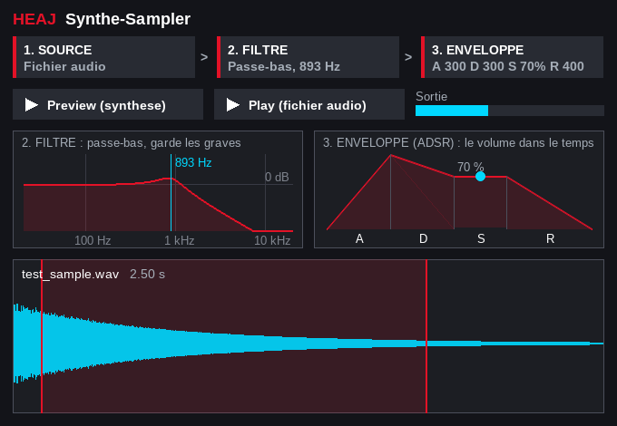

# Outils HEAJ pour Reaper

Trois outils gratuits pour le sound design d'environnements sonores dans [Reaper](https://www.reaper.fm/).
Ils accompagnent le cours « Environnements sonores » (Transmédia M1, Haute École Albert Jacquard, Namur).

| Outil | Type | Rôle |
|---|---|---|
| **HEAJ Lieux** | Effet (JSFX) | Placer un son dans un lieu : on choisit le lieu, puis la distance. |
| **HEAJ Synthé-Sampler** | Instrument (JSFX) | Apprendre la synthèse et le sampling : source, filtre, enveloppe. |
| **HEAJ Altération** | Script (ReaScript Lua) | Les gestes d'altération réunis dans une seule fenêtre. |

## Télécharger

Bouton vert **Code > Download ZIP**, en haut de cette page, puis décompressez l'archive.

## Installer

Les dossiers de ce dépôt reprennent ceux de Reaper : `Effects` et `Scripts`.

1. Dans Reaper : **Options > Show REAPER resource path in explorer/finder**.
2. Copiez le contenu du dossier `Effects` de ce dépôt dans le dossier `Effects` de Reaper.
3. Copiez le contenu du dossier `Scripts` de ce dépôt dans le dossier `Scripts` de Reaper.
4. Redémarrez Reaper : les deux plugins apparaissent dans la liste des effets, sous « JS ».
5. Pour le script : **Actions > Show action list > New action > Load ReaScript**, choisissez `HEAJ_Alteration.lua`, puis **Run**.

## HEAJ Lieux

Une réverbération pensée pour le sound design : pas de réglages techniques, des lieux.

- **Lieu** : 13 lieux réels (petite chambre, salle de bain, voiture, salle de classe, couloir, cage d'escalier, parking souterrain, hall de gare, église, grotte, ruelle, forêt, extérieur dégagé) et 3 lieux imaginaires (coque métallique, rêve sans fin, caverne de cristal).
- **Distance** : plus elle augmente, plus le son direct baisse et s'assombrit, plus la réverbération l'emporte.
- **Quantité de reverb** : un peu plus ou un peu moins que le réglage du lieu.
- **Son direct** : « Non » quand le plugin est sur une piste d'envoi partagée par plusieurs sons.

Astuce : un seul lieu pour toutes les pistes d'une même scène, c'est ce qui les fait sonner ensemble.

## HEAJ Synthé-Sampler

Un instrument volontairement minimal, en trois étages, chacun dessiné dans la fenêtre :

1. **Source** : un oscillateur (sinus, triangle, dent de scie, carré, bruit), ou un fichier audio glissé dans la fenêtre.
2. **Filtre** : passe-bas, passe-haut ou passe-bande. La courbe montre ce qui passe, fréquence par fréquence.
3. **Enveloppe ADSR** : attaque, décroissance, maintien, relâchement. La courbe se redessine à chaque réglage, et un point la parcourt pendant que la note sonne.

Pour écouter sans clavier : **Preview** joue l'oscillateur, **Play** joue le fichier audio. Un second clic arrête le son.
Pour jouer des notes : un clavier MIDI, ou **View > Virtual MIDI keyboard** avec la piste armée et le monitoring activé.
Le Do central (C4) rejoue le fichier audio à sa hauteur d'origine.

## HEAJ Altération

Sélectionnez un ou plusieurs items audio, puis cliquez :

- **Hauteur** : −12, −1, +1, +12 demi-tons.
- **Vitesse** : ÷2, ×0,8, ×1,25, ×2, avec la hauteur qui suit la vitesse (effet bande) ou non.
- **Transformer** : inverser, ou découper en huit morceaux mélangés au hasard.
- **Terminer** : tout remettre à zéro, ou figer le résultat en audio (nouvelle prise, l'original reste dans une autre prise).

Chaque geste s'annule avec Ctrl+Z (Cmd+Z sur Mac).

## Bon à savoir

- Ce sont des fichiers texte que Reaper lit directement : rien d'autre à installer.
- Les noms des réglages sont écrits sans accents, pour s'afficher correctement partout.
- Un souci ou une idée : ouvrez une *issue* sur ce dépôt.
